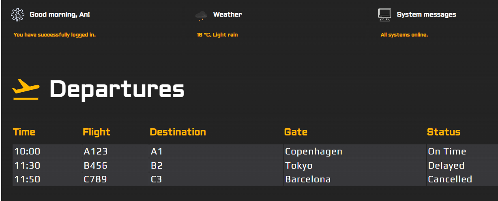

# Dashboard Flights



## Getting Started

1. Clone the repository:

   ```bash
   git clone https://github.com/yourusername/yourproject.git
   cd yourproject
   ```

2. Install necessary dependencies:

   ```bash
   npm install
   ```

3. Create a `.env.local` file by copying the provided `.env.example` file in the root directory:

   ```bash
   cp .env.example .env.local
   ```

4. Run the development server:

   ```bash
   npm run dev
   ```

## Backend Requirement

The dashboard requires the backend flights API to be running and accessible at the URL specified in your `.env.local` (e.g., `http://localhost:9090/flights`).

Make sure to start the backend server before using the dashboard to see live data.

For detailed backend/API setup instructions, see [documentation/API-Endpoints.md](documentation/API-Endpoints.md).

## Documentation

- [Developer Guidelines](documentation/Developer-Guidelines.md)
- [Frontend Architecture](documentation/Frontend-Architecture.md)
- [Testing](documentation/Testing.md)
- [API Endpoints](documentation/API-Endpoints.md)
- [UX Guidelines](documentation/UX-Guidelines.md)
- [Error Handling](documentation/Error-Handling.md)
- [Security](documentation/Security.md)
- [Dockerize](documentation/Dockerize.md)
- [Hydration](documentation/Hydration.md)
- [Github Actions](documentation/GitHub-Actions.md)
- [Authentication](documentation/Authentication.md)
